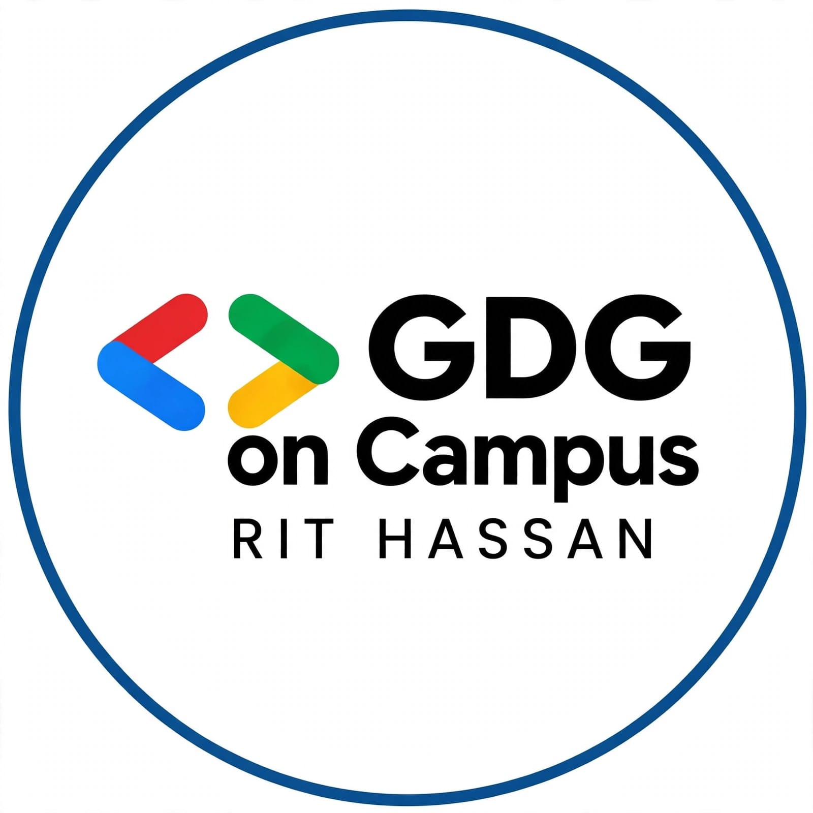
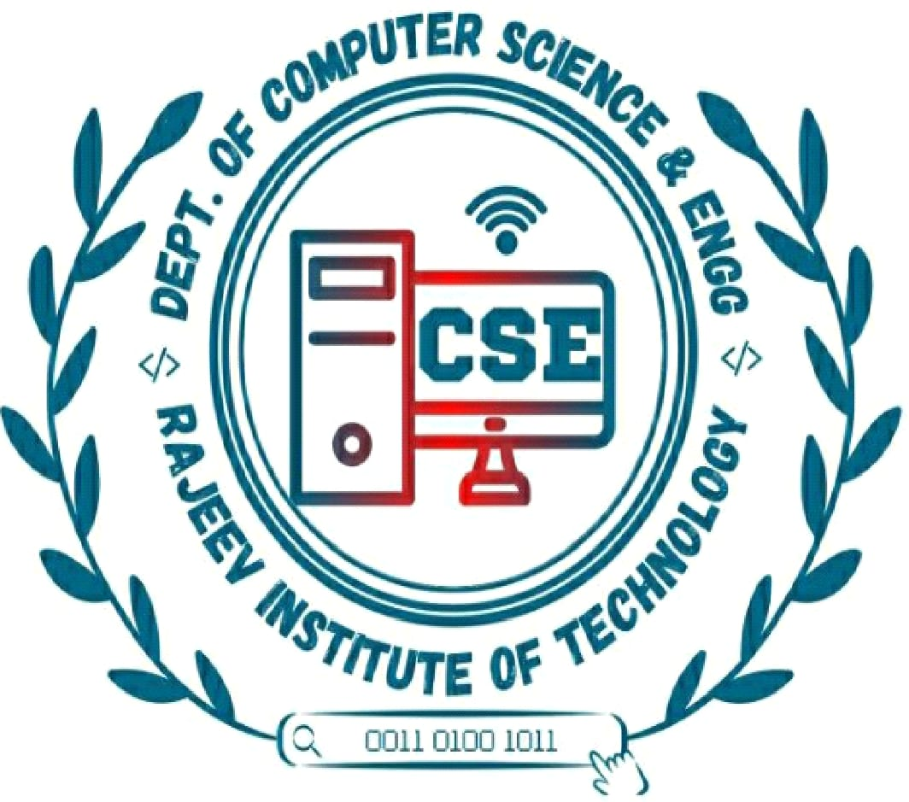

<div align="center">



# 🚀 CODESTORM 2026

### NOVEMBER EDITION

**GDG ON CAMPUS – RIT HASSAN**

### Think. Create. Innovate. Build the Future.

A community-driven technical challenge to encourage creativity, innovation, coding, and real-world problem-solving.


<br>

[🌐 Official Website](https://gdg-rit-website.vercel.app/) •
[📸 Instagram](https://www.instagram.com/gdg_club_rit/) •
[📝 Register Now](https://docs.google.com/forms/d/e/1FAIpQLSfiNUxgTFl5OUxDKGxGDlW-bbP6dp5K-6jYpWEdOtIbNw8vig/viewform)

</div>

---

## 🏛️ About CODESTORM 2026

**CODESTORM 2026 – November Edition** is a technical challenge organized by **Google Developer Groups on Campus – Rajeev Institute of Technology, Hassan**, under the Department of Computer Science and Engineering.

This initiative provides a platform for students to transform ideas into practical solutions through website development, innovative thinking, and real-world problem-solving.

Participants can demonstrate their technical knowledge, creativity, teamwork, and problem-solving abilities.

## 🏫 Organization Logo Preview

<div align="center">

| GDG Club | College | Department |
|:---:|:---:|:---:|
|  |  |  |
| **GDG on Campus** | **RIT Hassan** | **CSE Department** |

</div>

---

## 📌 Event Information

| Details | Information |
|---|---|
| Event Name | CODESTORM 2026 |
| Edition | November Edition |
| Organizer | GDG on Campus – RIT Hassan |
| Institution | Rajeev Institute of Technology, Hassan |
| Department | Computer Science and Engineering |
| Participation | Individual / Team |
| Difficulty | Beginner to Advanced |
| Number of Challenges | 2 |
| Student Coordinator | Yashawantha H M |

---

## 🏆 Challenges

Two exciting technical challenges designed to encourage creativity, innovation, and practical development skills.

### 💻 Challenge 01 – Website Building Challenge

**Theme: Design • Develop • Deploy**

Build a professional, responsive, and interactive website for a meaningful purpose.

Participants can develop websites based on:

- Education and learning
- College and student communities
- Technology and innovation
- Business and entrepreneurship
- Agriculture and rural development
- Healthcare and well-being
- Environment and sustainability
- Social impact

**Key Requirements:**

- Professional and attractive UI/UX.
- Responsive design for mobile, tablet, and desktop.
- College, department, and GDG club logos.
- Minimum three meaningful features.
- Functional navigation and working links.
- Public website deployment.
- GitHub source code.

**Challenge 01 Documentation**

| Document | Link |
|---|---|
| Challenge Overview | [Read More](challenges/challenge-01-website-building/README.md) |
| Problem Statement | [Read More](challenges/challenge-01-website-building/problem-statement.md) |
| Technical Requirements | [Read More](challenges/challenge-01-website-building/requirements.md) |
| Rules and Regulations | [Read More](challenges/challenge-01-website-building/rules.md) |
| Evaluation Criteria | [Read More](challenges/challenge-01-website-building/evaluation-criteria.md) |
| Submission Guidelines | [Read More](challenges/challenge-01-website-building/submission-guidelines.md) |

### 💡 Challenge 02 – Real-World Problem & Solution

**Theme: Identify • Innovate • Solve**

Identify a genuine real-world problem and propose or develop an innovative, practical solution using technology.

**Suggested Domains:**

- Education and learning
- Agriculture and rural development
- Healthcare and well-being
- Environment and sustainability
- Transportation and safety
- Technology and society
- Social impact

**Expected Focus Areas:**

- Real-world problem identification.
- Understanding the root cause.
- Innovative solution development.
- Technology and implementation approach.
- Practical feasibility.
- Positive social impact.

**Challenge 02 Documentation**

- [Challenge Overview](challenges/challenge-02-real-world-solutions/README.md)
- [Problem Statement](challenges/challenge-02-real-world-solutions/problem-statement.md)
- [Rules and Regulations](challenges/challenge-02-real-world-solutions/rules.md)

---

## 📊 Challenge 01 – Evaluation Criteria

| Evaluation Category | Marks |
|---|---:|
| UI/UX Design and Visual Appeal | 20 |
| Functionality and User Experience | 20 |
| Technical Implementation | 20 |
| Creativity and Innovation | 15 |
| Responsive Design | 10 |
| Code Quality and Organization | 10 |
| Project Presentation | 5 |
| **Total** | **100** |

*Refer to the detailed evaluation document for complete criteria.*

---

## 📚 Official Event Documentation

Explore the official event documents to understand CODESTORM 2026.

| Document | Description |
|---|---|
| [Event Overview](documents/event-overview.md) | Introduction, objectives, and event information |
| [Event Rules](documents/event-rules.md) | Official rules and regulations |
| [Participant Guidelines](documents/event-guidelines.md) | Development and participation guidelines |
| [Registration Details](documents/registration-details.md) | Registration process and event links |

---

## 📝 Official Registration

<div align="center">

### 🚀 Ready to take the challenge?

Register yourself and become part of CODESTORM 2026!

<br>

[](https://docs.google.com/forms/d/e/1FAIpQLSfiNUxgTFl5OUxDKGxGDlW-bbP6dp5K-6jYpWEdOtIbNw8vig/viewform)

</div>

**Important:** Registration and project submission are separate processes. Follow official announcements for project submission instructions and deadlines.

---

## 💬 Join Our WhatsApp Communities

Stay connected with GDG on Campus – RIT Hassan.

### 🌐 Official GDG Community

[](https://chat.whatsapp.com/Ep2J8GpmRBoF0Fj3A5eks1)

### 📢 November Edition Event Group

[](https://chat.whatsapp.com/IbvN7a5LEGpGqVoffjDWPw)

---

## 📜 General Rules and Guidelines

1. Participants must complete the official registration process.
2. Read all challenge-specific problem statements and requirements.
3. Submit original work and provide appropriate credit to third-party resources.
4. AI tools and open-source resources may be used responsibly.
5. Participants must understand and explain their submitted projects.
6. Follow the official submission instructions and deadlines announced by the organizers.
7. Maintain respectful communication with participants, judges, and organizers.
8. Plagiarism and unfair practices are prohibited.
9. Ensure submitted links are publicly accessible.

---

## 🛠️ Useful Developer Resources

Explore these resources to improve your development skills.

- [HTML, CSS and JavaScript – MDN](https://developer.mozilla.org/)
- [React Documentation](https://react.dev/)
- [Next.js Documentation](https://nextjs.org/docs)
- [Python Documentation](https://docs.python.org/3/)
- [GitHub Documentation](https://docs.github.com/)
- [Figma](https://www.figma.com/)
- [Vercel](https://vercel.com/)

More resources: [Explore Useful Resources](resources/useful-resources.md).

---

## 📁 Repository Structure

```text
codestorm-2026/
│
├── README.md
│
├── assets/
│   ├── Clg-Logo.jpeg
│   ├── Dept-Logo.jpeg
│   ├── GDG_CLUB-logo.jpeg
│   └── gdg form photo.jpg
│
├── documents/
│   ├── event-overview.md
│   ├── event-rules.md
│   ├── event-guidelines.md
│   └── registration-details.md
│
├── challenges/
│   ├── challenge-01-website-building/
│   │   ├── README.md
│   │   ├── problem-statement.md
│   │   ├── requirements.md
│   │   ├── rules.md
│   │   ├── evaluation-criteria.md
│   │   └── submission-guidelines.md
│   │
│   └── challenge-02-real-world-solutions/
│       ├── README.md
│       ├── problem-statement.md
│       └── rules.md
│
└── resources/
    └── useful-resources.md
```

---

## 🌟 Our Mission

To create a collaborative developer community where students learn, build, share knowledge, solve real-world problems, and grow together through technology.

**Think Creatively. Build Confidently. Innovate Continuously.**

---

## 👨‍💻 Student Coordinator

<div align="center">

### Yashawantha H M

**Student Coordinator**

Google Developer Groups on Campus  
Rajeev Institute of Technology, Hassan

</div>

---

## 🌐 Connect With Us

| Platform | Link |
|---|---|
| Official Website | [GDG RIT Hassan](https://gdg-rit-website.vercel.app/) |
| Instagram | [@gdg_club_rit](https://www.instagram.com/gdg_club_rit/) |
| GitHub Repository | [CODESTORM 2026](https://github.com/Yashawantha26/codestorm-2026) |
| GDG WhatsApp Community | [Join Community](https://chat.whatsapp.com/Ep2J8GpmRBoF0Fj3A5eks1) |
| November Event Group | [Join Group](https://chat.whatsapp.com/IbvN7a5LEGpGqVoffjDWPw) |

---

<div align="center">

# 🚀 CODESTORM 2026 – NOVEMBER EDITION

### Think. Create. Innovate. Build the Future.

**GDG ON CAMPUS – RIT HASSAN**

**LEARN TOGETHER. BUILD TOGETHER. GROW TOGETHER.**

Organized with ❤️ by GDG on Campus – RIT Hassan.

Developed and maintained by **Yashawantha H M**.

⭐ If you find this repository useful, consider giving it a star!

</div>
